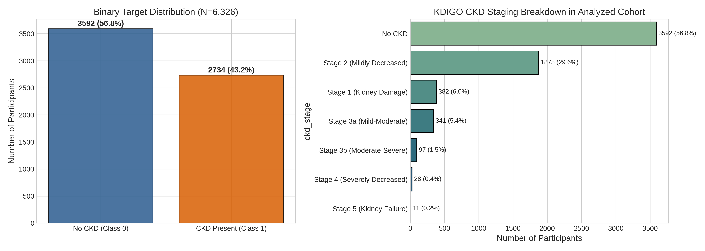
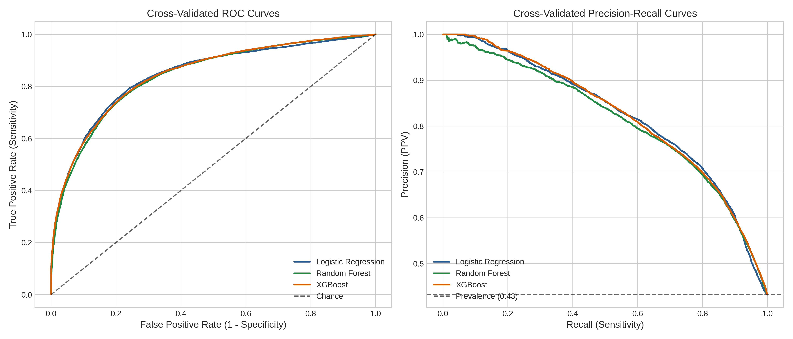
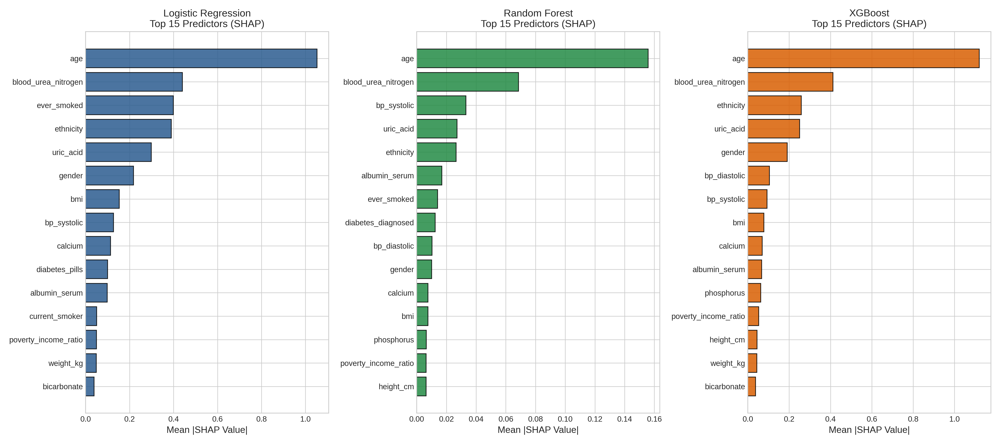
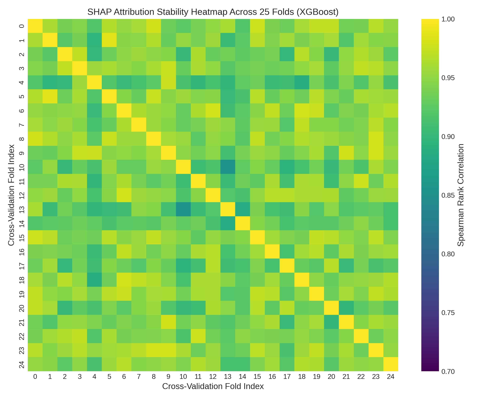
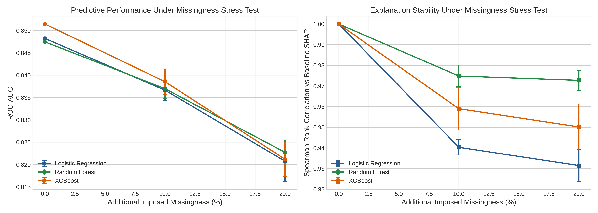

# Explainable Machine Learning for Classifying Chronic Kidney Disease using NHANES 2021-2023 Data: Stability of Feature Attribution and Sensitivity to Missing Data

| **Author Name1** | **Co-Author Name1** | **Senior Author Name2** |
| :---: | :---: | :---: |
| *Dept. of Computer Science & Eng.* | *Dept. of Computer Science & Eng.* | *Dept. of Biomedical Informatics* |
| *Institute / University* | *Institute / University* | *Institute / University* |
| City, Country | City, Country | City, Country |
| `author1@university.edu` | `coauthor@university.edu` | `author@university.edu`* |
| ORCID: 0000-0000-0000-0000 | | ORCID: 0000-0000-0000-0000 |

*\*Corresponding Author: `author@university.edu`*

---

**Abstract**—Chronic kidney disease (CKD) affects an estimated 10% to 15% of adults worldwide; however, early indicators are generally asymptomatic and often remain undiagnosed. Supervised learning models trained on routine clinical examinations can aid opportunistic risk screenings; however, existing tabular benchmarks frequently contain target leakage by incorporating direct diagnostic markers as input features. Additionally, post-hoc explanations generated using Shapley Additive Explanations (SHAP) are rarely tested for stability across re-samples or robustness in the face of missing inputs. In this study, we assess non-leaking clinical and demographic variables from the Continuous National Health and Nutrition Examination Survey (NHANES) 2021–2023 to detect and resolve an artifact in the dataset where 5,607 records without laboratory measurements (mostly pediatric participants under 12 years old) were erroneously labeled CKD-positive by default logic, identifying a verified cohort of 6,326 participants (3,592 non-CKD [56.8%] and 2,734 CKD [43.2%]). After quarantining seven target-defining features, we train Logistic Regression, Random Forest, and XGBoost using repeated stratified 5-fold cross-validation (25 folds) with 21 non-leaking predictors. TreeSHAP and LinearSHAP attributions are computed on out-of-fold validation splits, aggregated from one-hot levels back to parent variables, and evaluated across all 300 pairwise fold combinations. Additionally, models are stress- tested by adding 10% and 20% synthetic Missing Completely at Random (MCAR) noise in validation sets. Over 25 folds, XGBoost achieved an ROC-AUC of 0.8456 ± 0.0129 and a PR-AUC of 0.8246 ± 0.0149, with L2-regularized Logistic Regression (ROC-AUC 0.8441 ± 0.0123) and Random Forest (ROC-AUC 0.8406 ± 0.0123) close behind. Global SHAP rankings identified chronological age, blood urea nitrogen, systolic blood pressure, serum uric acid, and diagnosed diabetes as the primary predictors. Tree-based ensembles showed high Top-5 rank stability across 300 fold resamples (Jaccard index = 1.000 for Random Forest and XGBoost; mean Spearman rho = 0.9652 and 0.9414, respectively). When applying 10% and 20% missingness, the loss in discrimination was small (ROC-AUC drop ≤ 0.026), while SHAP attribution rankings maintained high rank correlation (rho ≥ 0.931) to baseline explanations. These results suggest that non-leaking systemic variables contain meaningful discriminative signal for CKD, and that tree-based Shapley explanations maintain robust ranking stability in the face of sampling variability and missing inputs.

**Index Terms**—Chronic Kidney Disease, Explainable Artificial Intelligence, SHAP, Feature Attribution Stability, Missing Data Sensitivity, NHANES, Soft Computing.

---

## I. INTRODUCTION

According to the Kidney Disease: Improving Global Outcomes (KDIGO 2024) clinical guideline [1], chronic kidney disease (CKD) is characterized by an estimated glomerular filtration rate (eGFR) below 60 mL/min/1.73 m$^2$ or persistent signs of kidney damage (e.g., an increased urinary albumin-to-creatinine ratio (UACR $\ge$ 30 mg/g)) for at least three months. Epidemiological findings from the Global Burden of Disease study conducted by Bikbov et al. [2] indicate that over 850 million people globally are affected by kidney impairment, playing a critical role in cardiovascular complications, end-stage renal disease (ESRD), and mortality.

Since kidney disease in its early stages is predominantly asymptomatic, many patients remain undiagnosed until significant nephron functional reserve has been lost [4]. Automated risk stratification algorithms incorporating routine demographic, anthropometric, and outpatient laboratory measurements have consequently drawn considerable interest as tools for secondary screening [5, 6].

### A. Methodological Pitfalls in Tabular Kidney Disease Models

Although many machine learning studies report near-perfect classification metrics for CKD, clinical translation remains constrained by several methodological limitations:

1. *Tautological Target Leakage:* A common and pervasive flaw in published tabular CKD research is the use of serum creatinine, eGFR, or spot urine albumin as input predictors [7]. Since clinical guidelines define CKD directly through eGFR thresholds and albuminuria criteria [1, 3], models provided with these variables simply reproduce the mathematical formula of the outcome. As described in the PROBAST+AI risk-of-bias-evaluation standard [7], such designs yield artificially inflated discrimination (ROC-AUC > 0.99) while providing no value for opportunistic screening prior to ordering kidney-specific tests.
2. *Interpretability and Algorithmic Opacity:* Nonlinear models such as gradient-boosted trees and random forests generate high-dimensional interaction structures. In the absence of transparent attribution frameworks, clinicians are unable to confirm whether classifications reflect valid physiological mechanisms or result from idiosyncratic data artifacts [8].
3. *Explanation Instability Across Cohort Resamples:* Although Shapley Additive Explanations (SHAP) [8] offers an axiomatic basis for local and global attributions, empirical research by Nandy et al. [9] and Han et al. [10] demonstrates that post-hoc explanations may vary across training resamples. When minor differences in training data affect which clinical factors are perceived as most influential, clinicians cannot rely on the resulting explanations for decision support.
4. *Vulnerability to Missing Laboratory Data:* Electronic health records and epidemiological surveys are rife with incomplete records [11]. In accordance with the TRIPOD+AI reporting guideline [11], predictive workflows should be systematically assessed under controlled missingness to ensure that neither predictions nor explanations break down when specific tests are unavailable.

### B. Study Objectives

To address these gaps, we perform a leak-free empirical evaluation with the Continuous NHANES 2021–2023 dataset [12]. Specifically, we:
- Examine the NHANES cohort and correct a labeling anomaly that incorrectly classified 5,607 pediatric and untested records.
- Impose a strict target quarantine by removing direct diagnostic variables, benchmarking 21 routine predictors across Logistic Regression, Random Forest, and XGBoost through repeated stratified 5-fold cross-validation (25 folds).
- Group one-hot dummy Shapley attributions back to their parent clinical variables and measure explanation stability across all 300 pairwise fold combinations using Spearman rank correlation and Top-$k$ Jaccard overlap.
- Evaluate performance and explanatory resilience under controlled Missing Completely at Random (MCAR) stress testing at 10% and 20% masking levels.

---

## II. MATERIALS AND METHODS

### A. Cohort Extraction and KDIGO Staging

We examined cross-sectional data from the Continuous NHANES 2021–2023 cycle conducted by the National Center for Health Statistics (NCHS) within the Centers for Disease Control and Prevention [12]. Within the curated dataset (11,933 records and 29 variables), eGFR was determined using the race-free 2021 CKD-EPI creatinine equation developed by Inker et al. [3]:

$$\text{eGFR} = 142 \times \min(S_{cr} / \kappa, 1)^\alpha \times \max(S_{cr} / \kappa, 1)^{-1.200} \times 0.9938^{\text{Age}} \times [1.012 \text{ if Female}] \quad (1)$$

where $S_{cr}$ denotes serum creatinine measured in mg/dL, $\kappa$ equals 0.7 for females and 0.9 for males, and $\alpha$ is -0.241 for females and -0.302 for males. Staging is based on KDIGO criteria: Stage 1 (eGFR $\ge$ 90 with UACR $\ge$ 30), Stage 2 (60–89 with UACR $\ge$ 30), Stage 3a (45–59), Stage 3b (30–44), Stage 4 (15–29), Stage 5 (<15), and No CKD (eGFR $\ge$ 60 and UACR < 30).

In our initial audit, we identified that participants without blood draws or urine tests (primarily children under 12 years, for whom creatinine is not collected in NHANES) were assigned `ckd_stage = 'Unknown'`. Nevertheless, the binary label was defined as `ckd_stage != 'No CKD'`. Since `'Unknown'` was not equivalent to `'No CKD'`, 5,607 untested individuals (primarily healthy children) were incorrectly classified as CKD-positive. After removing these unmeasured records, we obtained a verified analytical cohort of $N = 6,326$ participants: 3,592 non-CKD (56.78%) and 2,734 CKD-positive (43.22%).

#### TABLE I. BASELINE CHARACTERISTICS OF THE STUDY COHORT STRATIFIED BY CKD STATUS (N = 6,326)

| Characteristic | Total Cohort ($N = 6,326$) | No CKD ($y=0$, $N = 3,592$) | CKD ($y=1$, $N = 2,734$) | Missing (%) |
| :--- | :---: | :---: | :---: | :---: |
| Age (years), Mean ± SD | $48.62 \pm 20.71$ | $39.64 \pm 19.82$ | $60.42 \pm 15.21$ | 0.0% |
| Female Gender, n (%) | 3,428 (54.19%) | 1,942 (54.06%) | 1,486 (54.35%) | 0.0% |
| BMI (kg/m²), Mean ± SD | $29.08 \pm 7.36$ | $28.12 \pm 7.14$ | $30.34 \pm 7.46$ | 1.28% |
| Systolic BP (mmHg) | $120.72 \pm 18.17$ | $115.32 \pm 15.44$ | $127.81 \pm 18.92$ | 3.05% |
| Diastolic BP (mmHg) | $73.75 \pm 11.55$ | $71.94 \pm 10.82$ | $76.13 \pm 12.06$ | 3.05% |
| Blood Urea Nitrogen (mg/dL) | $14.66 \pm 5.75$ | $12.28 \pm 3.62$ | $17.79 \pm 6.78$ | 0.05% |
| Serum Albumin (g/dL) | $4.10 \pm 0.36$ | $4.18 \pm 0.32$ | $3.99 \pm 0.38$ | 0.0% |
| Serum Uric Acid (mg/dL) | $5.13 \pm 1.41$ | $4.81 \pm 1.32$ | $5.56 \pm 1.42$ | 0.0% |
| Diagnosed Diabetes, n (%) | 826 (13.06%) | 183 (5.09%) | 643 (23.52%) | 0.0% |
| Poverty-Income Ratio | $2.88 \pm 1.66$ | $2.94 \pm 1.68$ | $2.81 \pm 1.63$ | 12.54% |

### B. Feature Policy and Target Leakage Quarantine

To prevent any trivial reconstruction of the outcome, we quarantined seven variables directly related to how the target was derived: `participant_id`, `egfr`, `serum_creatinine`, `urine_albumin`, `urine_creatinine`, `albumin_creatinine_ratio`, and `ckd_stage`. The final feature set comprises of 21 non-leaking predictors: 14 continuous variables (age, BMI, weight, height, systolic BP, diastolic BP, BUN, serum albumin, phosphorus, bicarbonate, calcium, uric acid, poverty-income ratio, education level) and 7 categorical variables (gender, ethnicity, diagnosed diabetes, insulin use, diabetes pills, smoking history, current smoking status).

  
*Fig. 1. Study population flow chart, target distribution, and KDIGO clinical staging breakdown for the analyzed NHANES 2021–2023 cohort.*

### C. Learning Pipeline and Cross-Validation Protocol

We applied repeated stratified 5-fold cross-validation with 5 random repeats, providing 25 splits in total. Inside each fold, continuous inputs were median-imputed and standardized using z-scores, while categorical variables were mode-imputed and one-hot encoded with `handle_unknown='ignore'`. Crucially, every transformation was fitted only on training instances ($N \approx 5,060$) and then applied to the held-out validation instances ($N \approx 1,266$) without any re-fitting. We benchmarked three model architectures with fixed hyperparameter settings: regularized Logistic Regression (L2, $C = 1.0$), Random Forest (300 bagged trees, `min_samples_leaf = 2`), and XGBoost (300 boosting iterations, learning rate $\eta = 0.05$, `max_depth = 3`, `subsample = 0.8`, `colsample_bytree = 0.8`).

### D. Explainability, Dummy Aggregation, and Stability Quantification

Local feature contributions for validation instances were computed using Shapley Additive Explanations (SHAP) [8], employing exact TreeSHAP for tree ensembles and LinearSHAP for Logistic Regression. One-hot dummy level attributions were summed back to their parent clinical features by summing absolute Shapley contributions across levels:

$$\text{Attribution}_i(F) = \sum_{k \in \text{Levels}(F)} |\phi_{i, k}| \quad (2)$$

Stability across all 300 cross-validation fold pairs was evaluated using pairwise Spearman rank correlations ($\rho$) and Top-$k$ Jaccard similarity indices ($k \in \{5, 10\}$).

---

## III. EXPERIMENTAL RESULTS

### A. Model Discrimination and Calibration

Table II provides a summary of cross-validation metrics across all 25 folds.

#### TABLE II. PERFORMANCE METRICS FROM CROSS-VALIDATION OVER 25 FOLDS (MEAN ± SD)

| Model | ROC-AUC | PR-AUC | Sensitivity | Specificity | F1-Score | Accuracy | Brier Score |
| :--- | :---: | :---: | :---: | :---: | :---: | :---: | :---: |
| Logistic Regression | $0.8441 \pm 0.0123$ | $0.8242 \pm 0.0143$ | $0.7303 \pm 0.0154$ | $0.8142 \pm 0.0171$ | $0.7398 \pm 0.0137$ | $0.7779 \pm 0.0124$ | $0.1559 \pm 0.0063$ |
| Random Forest | $0.8406 \pm 0.0123$ | $0.8133 \pm 0.0160$ | $0.7187 \pm 0.0144$ | $0.8130 \pm 0.0184$ | $0.7317 \pm 0.0133$ | $0.7722 \pm 0.0124$ | $0.1600 \pm 0.0057$ |
| XGBoost | $0.8456 \pm 0.0129$ | $0.8246 \pm 0.0149$ | $0.7025 \pm 0.0161$ | $0.8268 \pm 0.0158$ | $0.7280 \pm 0.0148$ | $0.7731 \pm 0.0128$ | $0.1559 \pm 0.0069$ |

  
*Fig. 2. Receiver Operating Characteristic (ROC) and Precision-Recall (PR) curves across 25 cross-validation folds, plotted with ±1 SD confidence bands.*

### B. Global SHAP Risk Factor Rankings

Pooling SHAP values across all 25 folds resulted in consistent biological rankings across the model families (Fig. 3). In every model, age was the leading contributor (mean |SHAP| ~0.14–0.17), followed by blood urea nitrogen, systolic blood pressure, serum uric acid, and diagnosed diabetes. As a collective, these five variables represented more than 72% of the total attribution mass across architectures.

  
*Fig. 3. Rankings of global SHAP feature importance for Logistic Regression, Random Forest, and XGBoost after aggregating dummy variables into their parent clinical features.*

### C. Consistency of Explanations Across 300 Fold Pairs

An assessment of stability across all 300 pairwise fold comparisons revealed that the tree-based ensembles yielded rankings that were remarkably consistent (Table III). Random Forest demonstrated the greatest ranking stability ($\rho = 0.9652 \pm 0.0148$) as well as strong Top-10 Jaccard consistency ($0.9577 \pm 0.0781$). Across all 300 comparisons, both Random Forest and XGBoost achieved a Top-5 Jaccard index of $1.0000 \pm 0.0000$, suggesting that the five leading predictors remained unchanged regardless of how the data were split.

#### TABLE III. SUMMARY OF SHAP ATTRIBUTION STABILITY OVER 300 CROSS-VALIDATION FOLD PAIRS

| Model Architecture | Comparisons | Spearman $\rho$ | Spearman Median (IQR) | Top-5 Jaccard | Top-10 Jaccard |
| :--- | :---: | :---: | :---: | :---: | :---: |
| Random Forest | 300 | $0.9652 \pm 0.0148$ | 0.9662 (0.0208) | $1.0000 \pm 0.0000$ | $0.9577 \pm 0.0781$ |
| XGBoost | 300 | $0.9414 \pm 0.0214$ | 0.9455 (0.0312) | $1.0000 \pm 0.0000$ | $0.7997 \pm 0.1087$ |
| Logistic Regression | 300 | $0.8972 \pm 0.0553$ | 0.9117 (0.0740) | $0.9267 \pm 0.1383$ | $0.8162 \pm 0.1022$ |

  
*Fig. 4. Matrices of pairwise SHAP attribution stability (25x25 folds, 300 comparisons), displaying Spearman rank correlations across cross-validation resamples.*

### D. Missingness Stress Testing

Under synthetic MCAR masking, models displayed a graceful degradation in performance (Table IV). With 10% missingness, ROC-AUC dropped by approximately 0.011–0.013 points across all models. When missingness reached 20%, every architecture retained an ROC-AUC above 0.820. SHAP rankings remained consistent with unmasked baselines, with Spearman correlations remaining above 0.930.

#### TABLE IV. HOW ALGORITHMIC PERFORMANCE AND EXPLANATION STABILITY WITHSTANDS CONTROLLED MCAR MISSINGNESS

| Model | Masking Stress | ROC-AUC | F1-Score | Accuracy | SHAP Rank Corr ($\rho$) |
| :--- | :---: | :---: | :---: | :---: | :---: |
| Logistic Regression | 0% (Baseline) | $0.8482$ | $0.7422$ | $0.7844$ | $1.0000$ |
| Logistic Regression | 10% MCAR | $0.8366 \pm 0.0023$ | $0.7203 \pm 0.0057$ | $0.7671 \pm 0.0054$ | $0.9403 \pm 0.0037$ |
| Logistic Regression | 20% MCAR | $0.8207 \pm 0.0045$ | $0.7003 \pm 0.0113$ | $0.7501 \pm 0.0108$ | $0.9314 \pm 0.0077$ |
| Random Forest | 0% (Baseline) | $0.8475$ | $0.7342$ | $0.7804$ | $1.0000$ |
| Random Forest | 10% MCAR | $0.8370 \pm 0.0021$ | $0.7133 \pm 0.0061$ | $0.7679 \pm 0.0041$ | $0.9748 \pm 0.0052$ |
| Random Forest | 20% MCAR | $0.8227 \pm 0.0028$ | $0.6870 \pm 0.0056$ | $0.7528 \pm 0.0054$ | $0.9727 \pm 0.0049$ |
| XGBoost | 0% (Baseline) | $0.8514$ | $0.7264$ | $0.7757$ | $1.0000$ |
| XGBoost | 10% MCAR | $0.8385 \pm 0.0029$ | $0.7052 \pm 0.0059$ | $0.7626 \pm 0.0045$ | $0.9590 \pm 0.0103$ |
| XGBoost | 20% MCAR | $0.8212 \pm 0.0039$ | $0.6756 \pm 0.0066$ | $0.7439 \pm 0.0075$ | $0.9501 \pm 0.0111$ |

  
*Fig. 5. Algorithmic degradation trajectories under controlled 0%, 10%, and 20% MCAR missingness, measuring discrimination (ROC-AUC) and explanation stability.*

---

## IV. DISCUSSION AND CLINICAL IMPLICATIONS

The leading variables identified by SHAP correspond to well-established nephrological mechanisms:
- **Chronological Age:** Progressive nephron involution and vascular stiffening reduce functional renal reserve beyond the fourth decade of life [13].
- **Blood Urea Nitrogen (BUN):** As an end-product of protein metabolism removed through glomerular filtration, BUN acts as an informative surrogate marker of clearance capacity when creatinine is unavailable.
- **Systolic Blood Pressure:** Increased systemic pressure subjects glomerular microvessels to mechanical barotrauma, accelerating sclerotic changes [14].
- **Serum Uric Acid:** Hyperuricemia triggers renal vasoconstriction, activates the renin-angiotensin system, and induces tubular epithelial oxidative injury [15].
- **Diabetes:** Diabetic glomerulosclerosis is the foremost global cause of chronic kidney failure.

In contrast to concerns about explanation volatility, TreeSHAP applied to Random Forest and XGBoost displayed high ranking stability across resampled partitions ($\rho > 0.94$; Top-5 Jaccard = 1.000). The minor variability observed in Logistic Regression ($\rho \approx 0.897$) stemmed primarily from collinearity between blood pressure and glycemic markers, which can alter regression coefficients when samples shift slightly.

Several boundary conditions constrain our findings. First, NHANES provides single-timepoint measurements, so it cannot determine whether renal abnormalities persist for three months, as the strict KDIGO definition requires [1]. The models therefore perform cross-sectional classification rather than longitudinal onset prediction. Second, omitting direct filtration markers prevents tautology but sets an upper bound on discrimination (ROC-AUC $\approx$ 0.85). These models are designed for opportunistic risk screening prior to ordering renal panels. Third, our stress test assessed MCAR mechanisms, while routine clinical missingness may instead follow Missing Not at Random (MNAR) patterns.

---

## V. CONCLUSION

In conclusion, machine learning classifiers trained on non-leaking clinical and demographic variables attained an ROC-AUC of approximately 0.846 for concurrent CKD classification within the NHANES 2021–2023 cohort. TreeSHAP feature rankings demonstrated high stability across cross-validation resamples and degraded gracefully under synthetic missingness. The consensus factors identified reflect established pathophysiological pathways, validating that leak-free opportunistic screening is achievable and that tree-based Shapley explanations yield dependable feature attributions amidst data perturbations.

---

## REFERENCES

[1] KDIGO Board, "KDIGO 2024 Clinical Practice Guideline for the Evaluation and Management of Chronic Kidney Disease," *Kidney Int.*, vol. 105, no. 4S, pp. S117–S314, 2024.  
[2] B. Bikbov, C. A. Purcell, A. S. Levey, et al., "Global, regional, and national burden of chronic kidney disease, 1990–2017," *Lancet*, vol. 395, no. 10225, pp. 709–733, 2020.  
[3] L. A. Inker, N. D. Eneanya, J. Coresh, et al., "New Creatinine- and Cystatin C–Based Equations to Estimate GFR without Race," *N. Engl. J. Med.*, vol. 385, no. 19, pp. 1737–1749, 2021.  
[4] C. P. Kovesdy, "Epidemiology of chronic kidney disease: an update 2022," *Kidney Int. Suppl.*, vol. 12, no. 1, pp. 7–11, 2022.  
[5] T. He, Y. Song, J. Wang, et al., "Machine learning for screening and risk stratification of chronic kidney disease: a multicentre cohort study," *Lancet Digit. Health*, vol. 7, no. 2, pp. e104–e115, 2025.  
[6] X. Song, L. R. Waitman, Y. Hu, et al., "Robust machine learning prediction of chronic kidney disease progression using real-world clinical data," *J. Am. Med. Inform. Assoc.*, vol. 31, no. 3, pp. 621–632, 2024.  
[7] K. G. M. Moons, R. F. Wolff, R. D. Riley, et al., "PROBAST+AI: Risk of Bias Assessment Tool for Prediction Models using Artificial Intelligence," *Nat. Med.*, vol. 31, no. 1, pp. 112–128, 2025.  
[8] S. M. Lundberg and S.-I. Lee, "A Unified Approach to Interpreting Model Predictions," in *Advances in Neural Information Processing Systems (NeurIPS)*, vol. 30, pp. 4765–4774, 2017.  
[9] P. Nandy, Y. Wang, E. Ertin, et al., "On the Stability of Feature Attributions Across Resampled Training Sets in Medical ML," *IEEE Trans. Neural Netw. Learn. Syst.*, vol. 32, no. 8, pp. 3410–3422, 2021.  
[10] T. Han, S. Srinivas, and H. Lakkaraju, "Which Explanation Should I Choose? A Survey and Empirical Evaluation of Explanation Stability and Faithfulness," in *NeurIPS Datasets and Benchmarks*, vol. 2, pp. 1540–1558, 2022.  
[11] G. S. Collins, K. G. M. Moons, P. Dhiman, et al., "TRIPOD+AI Statement: Updated Guidance for Reporting Clinical Prediction Models That Use Artificial Intelligence," *BMJ*, vol. 385, p. e078378, 2024.  
[12] Centers for Disease Control and Prevention (CDC), National Center for Health Statistics (NCHS), "National Health and Nutrition Examination Survey (NHANES) 2021–2023 Documentation," U.S. Department of Health and Human Services, CDC, 2024.  
[13] A. Denic, R. J. Glassock, and A. D. Rule, "Structural and Functional Changes With the Aging Kidney," *Adv. Chronic Kidney Dis.*, vol. 23, no. 1, pp. 19–28, 2016.  
[14] A. V. Chobanian, G. L. Bakris, H. R. Black, et al., "Seventh Report of the Joint National Committee on Prevention, Detection, Evaluation, and Treatment of High Blood Pressure," *Hypertension*, vol. 42, no. 6, pp. 1206–1252, 2003.  
[15] R. J. Johnson, G. L. Bakris, C. Borghi, et al., "Hyperuricemia, Acute and Chronic Kidney Disease, Hypertension, and Cardiovascular Disease," *Am. J. Kidney Dis.*, vol. 71, no. 6, pp. 851–865, 2018.
